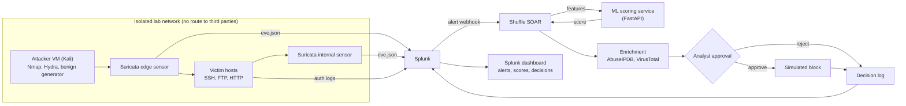

# Architecture

Version 0.1 | Day 1 (update after Day 2 once the real topology is confirmed)

## Trust boundaries
- Lab network: attacker, victims and sensors only.
- Management plane: Splunk, Shuffle, ML service.
- External enrichment (AbuseIPDB, VirusTotal) receives only the source IP.

## Evidence produced by each component
| Component | Evidence | Used for |
|---|---|---|
| Suricata | eve.json alerts | 8.16 monitoring, baseline comparison |
| Victim hosts | auth logs | 8.15 logging, 8.5 authentication |
| Splunk | alerts, dashboard | 8.16, traceability matrix |
| ML service | scores, version, model card | ISO 42001 lifecycle and monitoring |
| Shuffle | workflow runs, analyst decisions | 5.24 to 5.28, human oversight |
